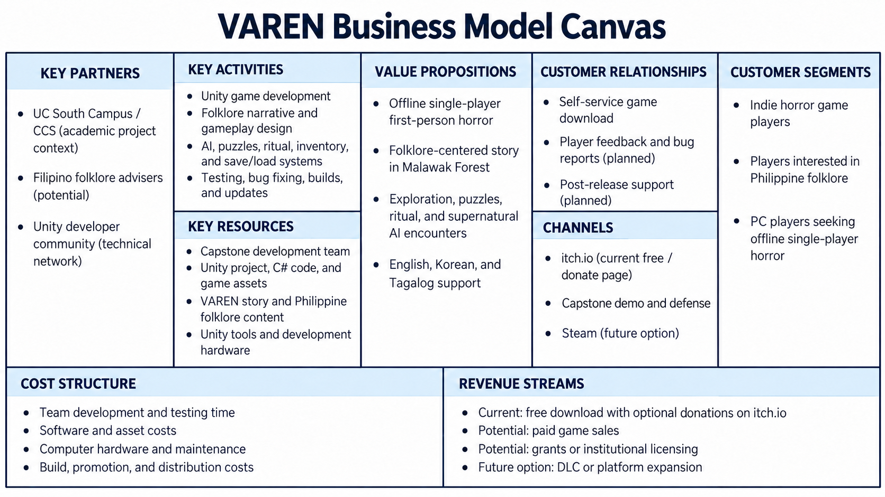

# VAREN Business Model Canvas

**Updated:** October 20, 2026

This canvas separates the current capstone project and distribution setup from possible future business opportunities. “Potential” and “planned” entries are proposals, not confirmed partnerships, revenue, or completed user research.

## Key Partners

- UC South Campus / College of Computer Studies — academic project context provided by the team; confirm any formal partnership wording.
- Filipino folklore advisers — potential consultants if engaged.
- Unity developer community — technical community and learning resource, not necessarily a formal partner.

## Key Activities

- Develop and maintain the Unity game.
- Design the Philippine folklore narrative and gameplay.
- Build and integrate AI encounters, puzzles, ritual progression, inventory, and save/load systems.
- Test, fix defects, prepare builds, and update project documentation.

## Key Resources

- Capstone development team and its design, programming, testing, and documentation skills.
- Unity project, C# code, scenes, prefabs, and other game assets.
- VAREN story and Philippine folklore content.
- Unity development tools and computer hardware.

## Value Propositions

- An offline, single-player, first-person horror game.
- Folklore-centered exploration and storytelling set in Malawak Forest.
- Puzzles, ritual progression, and supernatural AI encounters.
- Supported English, Korean, and Tagalog text.

## Customer Relationships

- Self-service download through the game page.
- Player feedback and bug reporting — planned; use channels that the team actively maintains.
- Post-release support and updates — planned.

## Channels

- itch.io — the project page screenshot supplied by the team shows a free download with optional donations.
- Capstone demonstration and defense — academic presentation channel.
- Steam — a possible future distribution channel, not a current release commitment.

## Customer Segments

- Players of indie horror games.
- Players interested in Philippine folklore.
- PC players looking for offline, single-player horror games.

Academic panels and faculty are project evaluators or stakeholders; they are not listed as paying customers here. Educational institutions could be a future customer segment if the game is packaged and validated for classroom use.

## Cost Structure

- Team development and testing time.
- Software, asset, and other production costs actually incurred.
- Computer hardware and maintenance.
- Build, promotion, and distribution costs.

Add actual amounts or identify donated/in-kind resources before presenting this as a financial forecast.

## Revenue Streams

- Current distribution shown in the supplied itch.io screenshot: free download with optional donations. No donation or sales income is confirmed by this canvas.
- Potential future paid game sales.
- Potential grants or institutional licensing, subject to funding and market validation.
- Possible DLC or expansion to other platforms if future demand supports it.

Academic credit, project completion, and certification are academic outcomes, not business revenue.
