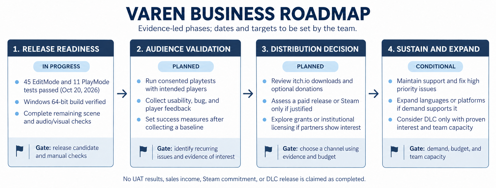

# VAREN Business Roadmap

**Status basis:** October 20, 2026

This roadmap outlines business and release decisions for VAREN. It uses evidence recorded in the project and the itch.io page setup shared by the team. Future opportunities are conditional; this document does not claim completed user acceptance testing, sales, grants, licensing, or a Steam release.

## 1. Release Readiness — In Progress

**Recorded progress:** Unity Test Runner reported 45/45 EditMode tests and 11/11 PlayMode tests passing. A Windows 64-bit Player build succeeded.

**Remaining work:** Complete the scene-based manual checks recorded in [Testing Regressions](TESTING_REGRESSIONS.md), including actual scene interactions, NavMesh behavior, immediate AI handoffs and Q&A input, quit/relaunch persistence, and visual/audio checks. Review the itch.io page, build requirements, and release materials.

**Milestone gate:** Prepare a release candidate after required manual checks pass and the team confirms the page and build are ready to share.

## 2. Audience Validation — Planned

- Recruit intended players, including indie horror players and people interested in Philippine folklore.
- Run consented playtests and collect usability observations, bug reports, completion feedback, and optional donation response.
- Establish a baseline before choosing numerical success targets; do not treat the automated test results as player acceptance results.
- Prioritize recurring issues and feed fixes into the next build.

**Milestone gate:** Summarize playtest findings, recurring problems, and evidence of player interest.

## 3. Distribution and Revenue Decision — Planned

- Review the current itch.io free-download/optional-donation setup shown in the team-provided page screenshot. No donation or sales income is confirmed here.
- Use audience feedback and actual distribution data to decide whether to keep that model or evaluate a paid release.
- Assess Steam only if the expected audience and release effort justify preparing another store page and build.
- Explore grants or institutional licensing only if an interested organization and a suitable educational package emerge.

**Milestone gate:** Choose a distribution approach using audience evidence, costs, platform requirements, and team capacity.

## 4. Sustain and Expand — Conditional

- Provide support and fixes for issues that affect players.
- Expand localization, platforms, or content only when player demand and team capacity support the work.
- Consider DLC or other paid expansions only after validating demand and estimating production and support costs.

**Milestone gate:** Approve expansion only when there is evidence of demand, a workable budget, and capacity to maintain it.

## Planning Notes

- Phases are ordered by dependency, not assigned calendar months. Add dates after confirming the capstone schedule and available team time.
- Do not add revenue forecasts, player targets, or performance targets until the team has a baseline and a defensible estimate.
- Academic credit and project defense are academic outcomes, not revenue.
- For the current business assumptions, see the [Business Model Canvas](BUSINESS_MODEL_CANVAS.md). For development and in-game flows, see the [Program Workflow](PROGRAM_WORKFLOW.md).
