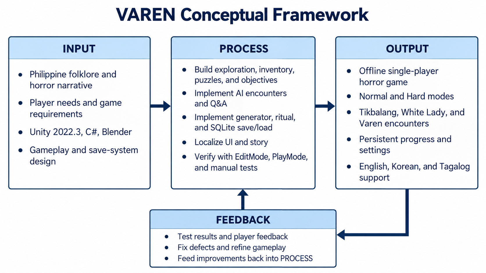

# VAREN Conceptual Framework

The framework follows an **Input → Process → Output** model with a feedback loop from the resulting game back to development.

| Stage | Current VAREN scope |
| --- | --- |
| Input | Philippine folklore and horror narrative, player and gameplay requirements, Unity 2022.3/C#/Blender tools, and gameplay and save-system design. |
| Process | Develop exploration, inventory, puzzles, objectives, AI encounters and Q&A, generator and ritual progression, SQLite save/load, localization, and automated and manual testing. |
| Output | An offline single-player horror game with Normal and Hard modes, Tikbalang/White Lady/Varen encounters, persistent progress and settings, and English/Korean/Tagalog support. |
| Feedback | Use test results and player feedback to identify defects and refine the process. |

This diagram describes the implemented project direction; it does **not** claim that multiplayer, adaptive difficulty, or user acceptance testing has been completed. For recorded automated results and remaining manual checks, see [Testing regressions](TESTING_REGRESSIONS.md).
